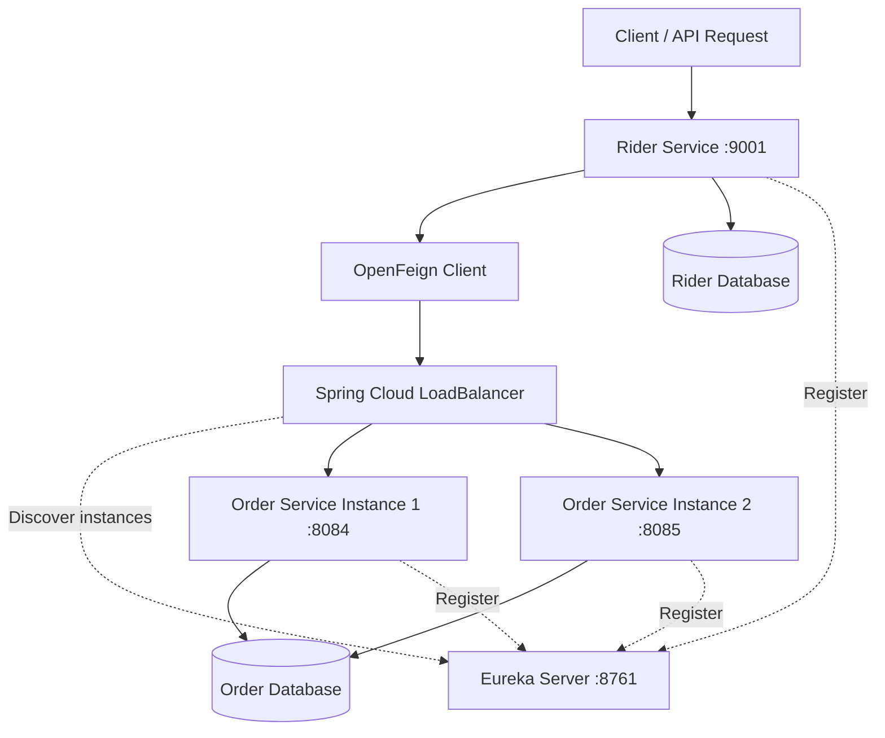

# Spring Boot Microservices — Service Discovery & Load Balancing

A hands-on microservices project demonstrating **service-to-service communication, service discovery with Netflix Eureka, declarative REST clients using OpenFeign, and client-side load balancing with Spring Cloud LoadBalancer**.

The project contains a Rider Service that communicates with multiple instances of an Order Service. Eureka maintains the service registry, while Spring Cloud LoadBalancer distributes requests across available Order Service instances.

## Table of Contents

- [Overview](#overview)
- [Architecture](#architecture)
- [Request Flow](#request-flow)
- [Technologies Used](#technologies-used)
- [Services and Ports](#services-and-ports)
- [Prerequisites](#prerequisites)
- [Project Setup](#project-setup)
- [Configuration](#configuration)
- [How to Run](#how-to-run)
- [Testing Load Balancing](#testing-load-balancing)
- [Key Concepts Learned](#key-concepts-learned)
- [Troubleshooting](#troubleshooting)
- [Future Improvements](#future-improvements)

## Overview

This project explores how independently running Spring Boot microservices discover and communicate with one another without hardcoding the destination service's host and port.

It consists of three main components:

- **Eureka Server:** Maintains a registry of available microservice instances.
- **Order Service:** Exposes order-related REST endpoints and can run as multiple instances.
- **Rider Service:** Communicates with the Order Service through OpenFeign and uses client-side load balancing to select an available instance.

The primary goal is to understand how service discovery and client-side load balancing work together in a Spring Cloud environment.

## Architecture



**Important:** Eureka provides service discovery; it does not itself distribute requests. Spring Cloud LoadBalancer selects a service instance on the client side.

## Request Flow

When a client calls an endpoint in the Rider Service that needs information from the Order Service, the following sequence takes place:

1. The client sends an HTTP request to the Rider Service.
2. The Rider Service invokes its OpenFeign client using the logical service name `demo-order-service`.
3. OpenFeign delegates instance selection to Spring Cloud LoadBalancer.
4. LoadBalancer obtains the available Order Service instances through service discovery.
5. It selects an instance, using round-robin selection by default under the standard configuration.
6. The request is sent to the selected Order Service instance.
7. The Order Service processes the request and returns the response.
8. The Rider Service receives the response and returns the appropriate result to its caller.

For example, repeated calls may alternate between:

- `http://localhost:8084/order/getPort`
- `http://localhost:8085/order/getPort`

The exact sequence depends on instance availability and the load-balancer configuration.

### How the components work together

| Component | Responsibility |
|---|---|
| Netflix Eureka Server | Maintains the service registry |
| Eureka Client | Registers a service and retrieves discovery information |
| OpenFeign | Defines declarative HTTP clients |
| Spring Cloud LoadBalancer | Selects a destination service instance |
| Spring Boot | Runs each microservice application |
| Spring Data JPA | Provides database access |
| MySQL | Stores application data |

## Technologies Used

- Java
- Spring Boot
- Spring Cloud
- Spring Cloud Netflix Eureka
- Spring Cloud OpenFeign
- Spring Cloud LoadBalancer
- Spring Web MVC
- Spring Data JPA
- MySQL
- Maven
- REST APIs
- IntelliJ IDEA

## Services and Ports

| Service | Application name | Default port |
|---|---|---:|
| Eureka Server | Your Eureka server application name | `8761` |
| Rider Service | `demo-rider-service` | `9001` |
| Order Service — Instance 1 | `demo-order-service` | `8084` |
| Order Service — Instance 2 | `demo-order-service` | `8085` |

Both Order Service instances share the same logical application name. Eureka can therefore register them as instances of the same service.

The Eureka dashboard is available at:

`http://localhost:8761`

## Prerequisites

Install or prepare the following before running the project:

1. A JDK compatible with the Java version configured in the project.
2. Maven, or the Maven wrapper included in the project.
3. MySQL Server.
4. IntelliJ IDEA or another Java IDE.
5. Git.
6. The Eureka Server application and the Rider and Order Service applications.

Verify your Java and Maven installations:

```bash
java -version
mvn -version
```

## Project Setup

### 1. Clone the repository

Replace the example URL with your actual GitHub repository URL.

```bash
git clone https://github.com/YOUR_USERNAME/spring-boot-microservices-discovery.git
cd spring-boot-microservices-discovery
```

If the applications are stored in separate repositories, clone each repository separately.

### 2. Configure MySQL

Create the databases used by the services:

```sql
CREATE DATABASE `demo-rider`;
CREATE DATABASE `demo-order`;
```

Update each application's database configuration to match your local MySQL username, password, host, and database name.

For a local development environment, you can use environment variables for credentials rather than committing passwords to Git.

### 3. Configure the Eureka Server

Start with your separate Eureka Server application.

Its configuration should include:

```yaml
server:
  port: 8761

spring:
  application:
    name: eureka-server

eureka:
  client:
    register-with-eureka: false
    fetch-registry: false
```

Make sure the Eureka Server application also has the appropriate Eureka Server dependency and is annotated with `@EnableEurekaServer`.

The server should be running before starting the other applications.

### 4. Configure the Rider Service

Example `application.yml` configuration:

```yaml
spring:
  application:
    name: demo-rider-service

  datasource:
    url: jdbc:mysql://localhost:3306/demo-rider
    username: ${DB_USERNAME:root}
    password: ${DB_PASSWORD}

  jpa:
    hibernate:
      ddl-auto: update
    show-sql: true
    properties:
      hibernate:
        format_sql: true

server:
  port: 9001

eureka:
  client:
    service-url:
      defaultZone: http://localhost:8761/eureka/
```

Configure `DB_USERNAME` and `DB_PASSWORD` in your environment before launching the application.

### 5. Configure the Order Service

Example `application.yml` configuration:

```yaml
spring:
  application:
    name: demo-order-service

  datasource:
    url: jdbc:mysql://localhost:3306/demo-order
    username: ${DB_USERNAME:root}
    password: ${DB_PASSWORD}

  jpa:
    hibernate:
      ddl-auto: update
    show-sql: true
    properties:
      hibernate:
        format_sql: true

server:
  port: 8084

eureka:
  client:
    service-url:
      defaultZone: http://localhost:8761/eureka/
```

The second Order Service instance can use the same configuration with a different server port, supplied when launching it.

**Security note:** Never commit real database credentials, API keys, or other secrets to a public GitHub repository.

## How to Run

Run the services in this order.

### Step 1: Start MySQL

Ensure your MySQL server is running and both databases have been created.

### Step 2: Start the Eureka Server

From the Eureka Server project directory, run:

```bash
mvn spring-boot:run
```

Alternatively, run the main application class from IntelliJ IDEA.

Open `http://localhost:8761` in your browser to verify that the dashboard loads.

### Step 3: Start Order Service — Instance 1

From the Order Service project directory:

```bash
mvn spring-boot:run
```

This instance uses port `8084` by default.

### Step 4: Start Order Service — Instance 2

Launch a second copy of the Order Service application on port `8085`.

With Maven, run the following from the Order Service project directory:

```bash
mvn spring-boot:run -Dspring-boot.run.arguments="--server.port=8085"
```

If you use IntelliJ IDEA, create another run configuration for the Order Service and set the program argument to:

```text
--server.port=8085
```

Both instances must use the same Eureka application name: `demo-order-service`.

If your Order Service has additional port-dependent configuration, verify that it works for both instances.

### Step 5: Start the Rider Service

From the Rider Service project directory:

```bash
mvn spring-boot:run
```

The Rider Service should start on port `9001` and register itself with Eureka.

### Step 6: Verify registration

Open:

`http://localhost:8761`

Look for these registered applications:

- `DEMO-RIDER-SERVICE`
- `DEMO-ORDER-SERVICE`

The Order Service should have two registered instances. Allow a short time for registration and the dashboard to refresh.

## Testing Load Balancing

The Order Service exposes a diagnostic endpoint:

```http
GET /order/getPort
```

Assuming this endpoint returns the port of the instance handling the request, test the instances directly:

```bash
curl http://localhost:8084/order/getPort
curl http://localhost:8085/order/getPort
```

Next, call the Rider Service endpoint that invokes the Feign client. If your Rider controller exposes a proxy endpoint for `getPort`, call that endpoint repeatedly and inspect the responses.

The Feign client should use the logical service name:

```java
@FeignClient(name = "demo-order-service")
public interface OrderServiceFeignClient {

    @GetMapping("/order/getPort")
    String getPort();
}
```

Do not specify a fixed `url` in the annotation if you want Eureka discovery and client-side load balancing to choose the destination.

If the endpoint is exposed through a Rider controller, the repeated responses should demonstrate that requests can reach both Order Service instances under the default round-robin configuration.

## Key Concepts Learned

- **Microservices architecture:** Splitting an application into independently running services.
- **Service discovery:** Finding service instances without hardcoding their network locations.
- **Service registration:** Publishing application instances to a registry.
- **OpenFeign:** Calling REST APIs through declarative Java interfaces.
- **Client-side load balancing:** Choosing a destination instance in the calling application's client stack.
- **Logical service names:** Calling `demo-order-service` instead of binding the client to a specific port.
- **Multiple instances:** Running multiple copies of the same microservice.
- **Spring Boot configuration:** Configuring application names, ports, database connections, and service discovery.

## Troubleshooting

### 1. `No servers available for service: demo-order-service`

Possible causes:

- The Order Service is not running.
- The Order Service failed to register with Eureka.
- The service name in `@FeignClient` does not match the registered application name.
- Eureka is unavailable or the client configuration is incorrect.

**What to check:** Verify both Order Service instances in the Eureka dashboard and confirm their application names.

### 2. HTTP 503 from OpenFeign

This can happen when LoadBalancer cannot find an available instance for the requested service.

**What to check:** Confirm service registration, application health, the Eureka URL, and the Feign client name.

### 3. Port already in use

If port `8084`, `8085`, `9001`, or `8761` is already occupied, the application may fail to start.

**What to check:** Stop the conflicting process or configure a different port.

### 4. MySQL connection failure

Possible causes include incorrect credentials, an unavailable MySQL server, or a missing database.

**What to check:** Verify the database URL, username, password environment variables, and database existence.

### 5. Only one Order Service instance appears

**What to check:** Ensure both instances are running, use the same `spring.application.name`, and register with the same Eureka Server.

Remember that the Eureka dashboard may take a short time to reflect registration changes.

## Future Improvements

Possible extensions to this project include:

- Add an API Gateway using Spring Cloud Gateway.
- Add centralized configuration using Spring Cloud Config.
- Introduce circuit breakers and fault tolerance with Resilience4j.
- Add centralized logging and distributed tracing.
- Add health checks and monitoring with Spring Boot Actuator.
- Containerize the applications with Docker Compose.
- Add integration tests for service discovery and inter-service communication.
- Add authentication and authorization between services.
- Experiment with custom load-balancing strategies.

## Learning Outcome

This project demonstrates how Spring Boot microservices can register with a service registry, discover other services dynamically, and communicate through OpenFeign with client-side load balancing across multiple service instances.

It provides a foundation for exploring more advanced Spring Cloud patterns and building distributed applications.
